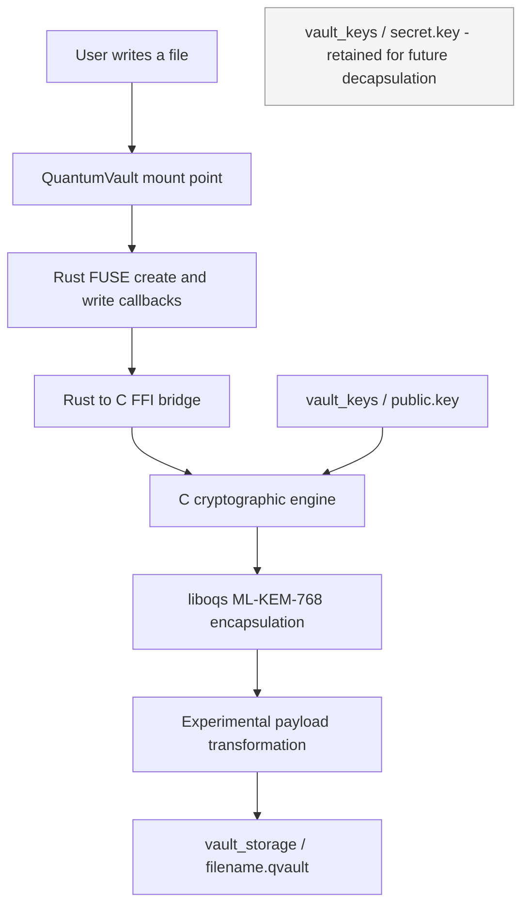

QuantumVault — Post-Quantum Encrypted Local Filesystem
QuantumVault is an experimental Linux filesystem prototype that explores how post-quantum cryptography can be connected to file operations through a userspace filesystem.

The project combines:
- Rust and FUSE for the virtual filesystem interface.
- C and Open Quantum Safe (liboqs) for post-quantum key operations.
- ML-KEM-768 (formerly CRYSTALS-Kyber) to establish a shared secret.
- A Rust-to-C Foreign Function Interface (FFI) bridge to connect the filesystem and cryptographic engine.
The current demonstration focuses on the write path: a file is written into the mounted directory, the FUSE write() callback invokes the C engine through FFI, and a corresponding .qvault backing file is created in vault_storage/.
Prototype and security notice: This is an academic proof of concept, not a production-ready secure filesystem. ML-KEM-768 is a key-encapsulation mechanism; it does not directly encrypt arbitrary file contents. The current C implementation places an ML-KEM encapsulation ciphertext before a payload transformed using a repeated-XOR operation with the derived shared secret. This is experimental and is not authenticated encryption or a secure file-encryption construction. Transparent decryption on read is not implemented. Do not use QuantumVault to store real confidential or sensitive data.

Contents
- Project objectives
- Current implementation
- Architecture and data flow
- Technologies
- Repository structure
- Prerequisites
- Installation and setup
- Build
- Run and mount
- Demonstration and verification
- Unmount
- Makefile commands
- Troubleshooting
- Security notes and limitations
- Planned work
- Week 1 — Implementation report
- Week 2 — Implementation report
Project objectives
1. Explore post-quantum cryptography using the Open Quantum Safe library.
2. Build a Linux userspace filesystem using Rust and FUSE.
3. Connect Rust filesystem callbacks to a C cryptographic library using FFI.
4. Intercept file write operations and create corresponding .qvault backing files.
5. Establish a foundation for future authenticated encryption, decryption, and more complete filesystem handling.
Current implementation
The following behavior has been implemented and demonstrated in the current Ubuntu development environment:
- A C shared library is compiled as build/libpqc_engine.so.
- The Rust FUSE application is built with Cargo.
- The filesystem mounts at /tmp/qvault_mount.
- The mounted filesystem exposes a built-in diagnostic file named hello.txt.
- A file written into the mount is handled by the FUSE create() and write() callbacks.
- The Rust code calls the C encryption routine through FFI.
- The C routine uses ML-KEM-768 encapsulation and the current experimental payload transformation.
- The resulting bytes are written to vault_storage/<filename>.qvault.
Verified during the local mid-week demonstration: make completed successfully; make mount mounted the filesystem after the mountpoint permissions were corrected; mountpoint confirmed the mount; writing a test file created its .qvault backing file; xxd displayed its binary contents; and a search for the exact sample plaintext string did not find that string in the backing file.

These checks demonstrate the current write-path behavior. They do not, by themselves, prove cryptographic security, authenticated encryption, or successful decryption.
Architecture and data flow

Component responsibilities
Component	Responsibility
FUSE	Provides the userspace filesystem interface and receives file operations.
Rust application	Implements filesystem callbacks such as create(), open(), and write().
FFI bridge	Allows Rust to call functions exported by the C shared library.
C cryptographic engine	Uses liboqs and ML-KEM-768 for key encapsulation and performs the current experimental payload transformation.
vault_keys/	Stores the ML-KEM public and secret key files. The current write path reads the public key for encapsulation; the secret key is not yet used by a decryption path.
vault_storage/	Stores the .qvault backing files generated by write operations.

Technologies
Technology	Use in this project
Ubuntu Linux	Development and runtime environment
Rust	FUSE filesystem implementation
C	Cryptographic engine
FUSE 3	Userspace filesystem support
Open Quantum Safe (liboqs)	Post-quantum cryptographic API
ML-KEM-768	Key encapsulation mechanism
Cargo	Rust build system
GNU Make	Build and run automation
GCC and CMake	C and liboqs compilation

Repository structure
2nd-Months-Cyber-Security-Project-Progress-Report-Weeks-1-4-Batch-22/
├── docs/                         # Project documentation
├── src/
│   ├── pqc_engine.c              # C cryptographic implementation
│   ├── pqc_engine.h              # C function declarations
│   └── quantumvault_fuse/
│       ├── Cargo.toml             # Rust dependencies
│       ├── build.rs               # FFI/build integration
│       └── src/
│           ├── main.rs            # FUSE filesystem implementation
│           └── ffi.rs             # Rust-to-C function declarations/wrappers
├── Makefile                      # Build, mount, unmount, and clean targets
├── .gitignore                    # Ignores generated files and key material
└── README.md
The following directories/files are created during building or running and may not exist in a fresh clone:
build/libpqc_engine.so
src/quantumvault_fuse/target/
vault_keys/public.key
vault_keys/secret.key
vault_storage/*.qvault
/tmp/qvault_mount/
Prerequisites
The commands below are intended for Ubuntu Linux with working FUSE support. A virtual machine running Ubuntu can also be used, provided FUSE is available to the guest system.

Install the system packages:
sudo apt update
sudo apt install -y \
    build-essential \
    cmake \
    ninja-build \
    libssl-dev \
    libfuse3-dev \
    fuse3 \
    pkg-config \
    git \
    curl \
    xxd
Install Rust
Install Rust using rustup:
curl --proto '=https' --tlsv1.2 -sSf https://sh.rustup.rs | sh -s -- -y
Load the Rust environment into the current terminal:
source "$HOME/.cargo/env"
Check the installation:
rustc --version
cargo --version
Build and install liboqs
The C engine uses the liboqs API. Build and install the library from the Open Quantum Safe repository:
git clone --depth 1 https://github.com/open-quantum-safe/liboqs.git /tmp/liboqs
cmake -S /tmp/liboqs \
      -B /tmp/liboqs/build \
      -DBUILD_SHARED_LIBS=ON \
      -DCMAKE_INSTALL_PREFIX=/usr/local
cmake --build /tmp/liboqs/build --parallel
sudo cmake --install /tmp/liboqs/build
sudo ldconfig
The project requires a liboqs build that provides the ML-KEM-768 API used in src/pqc_engine.c (OQS_KEM_alg_ml_kem_768).
Installation and setup
Clone the repository:
git clone https://github.com/vtu23484-cmd/2nd-Months-Cyber-Security-Project-Progress-Report-Weeks-1-4-Batch-22.git
Enter the project directory:
cd 2nd-Months-Cyber-Security-Project-Progress-Report-Weeks-1-4-Batch-22
Make sure the corrected Makefile is present. GNU Make requires each recipe command below a target to begin with a real TAB character. If make reports missing separator, inspect the recipe indentation in the Makefile.
Build
From the repository root, run:
make
The all target:
1. Creates the build/ directory.
2. Compiles src/pqc_engine.c as build/libpqc_engine.so and links it with liboqs.
3. Builds the Rust FUSE application using Cargo.
A successful build in the tested environment showed the GCC shared-library compilation followed by Cargo reporting that the quantumvault_fuse development profile had finished.
Run and mount
Create the mountpoint (the Makefile also creates it when running the mount target):
mkdir -p /tmp/qvault_mount
Start the filesystem as your normal Ubuntu user:
make mount
Do not run sudo make mount. FUSE should be launched by the user who owns the mountpoint.

The expected startup message is similar to:
[+] Mounting QuantumVault Read/Write FUSE at: /tmp/qvault_mount
Keep this terminal open while the filesystem is mounted. The FUSE application runs in the foreground.
Mountpoint permission fix
If you previously created /tmp/qvault_mount using sudo mkdir, it may be owned by root. If FUSE reports user has no write access to mountpoint, correct the ownership:
sudo chown "$USER":"$(id -gn)" /tmp/qvault_mount
Then run make mount again as your normal user.
Demonstration and verification
Use two terminal windows:
- Terminal 1: run make mount and leave it running.
- Terminal 2: execute the verification and demonstration commands below from the repository root.
1. Confirm that the mount is active
mountpoint /tmp/qvault_mount
Expected output:
/tmp/qvault_mount is a mountpoint
List the virtual directory:
ls -la /tmp/qvault_mount
The built-in diagnostic file should be visible:
cat /tmp/qvault_mount/hello.txt
Expected output:
Hello World from QuantumVault FUSE!
2. Write a test file through the mount
In Terminal 2, from the repository root, create a fresh filename and sample message:
DEMO_NAME="midweek_review_$(date +%s).txt"
DEMO_TEXT="QuantumVault mid-week demonstration"
printf '%s\n' "$DEMO_TEXT" > "/tmp/qvault_mount/$DEMO_NAME"
echo "Created: $DEMO_NAME"
The write is sent to the FUSE filesystem. The current write() callback calls the Rust-to-C FFI wrapper and the C processing routine.
3. Check the backing file
ls -lh vault_storage/
ls -lh "vault_storage/${DEMO_NAME}.qvault"
The expected backing filename is:
vault_storage/<demonstration-filename>.qvault
4. Inspect the backing file in hexadecimal
xxd "vault_storage/${DEMO_NAME}.qvault" | head -n 10
This displays the backing file as hexadecimal bytes. It is useful for inspecting the binary output, but hexadecimal output alone does not establish cryptographic security.
5. Check for the exact sample plaintext string
if grep -aFq "$DEMO_TEXT" "vault_storage/${DEMO_NAME}.qvault"; then
    echo "Original plaintext string found in backing file"
else
    echo "Exact original plaintext string not found"
fi
An output saying the exact string was not found confirms only that this exact byte sequence is not present in the backing file. It is not a substitute for a cryptographic security test.
6. Check key-file presence and permissions
ls -ld vault_keys
ls -l vault_keys/
The expected key filenames are:
vault_keys/public.key
vault_keys/secret.key
The application creates the keypair if public.key is absent. If it already exists, the current startup code does not generate a fresh keypair on every mount.

Restrict access to the key directory and secret key:
chmod 700 vault_keys
chmod 600 vault_keys/secret.key
chmod 644 vault_keys/public.key
Verify again:
ls -ld vault_keys
ls -l vault_keys/
The secret key should show owner-only read/write permission (-rw-------), and the key directory should show owner-only access (drwx------). Never print the contents of secret.key or commit it to source control.
7. Optional Git ignore check
The repository .gitignore includes vault_keys/ and generated storage/build paths. Check that key files are not tracked:
git ls-files vault_keys/
git status --short --ignored vault_keys/
An empty git ls-files vault_keys/ output means no files in that directory are currently tracked in the checked-out Git index. The !! vault_keys/ status indicates that Git is ignoring the directory. This local check alone does not prove that key material was never committed in any remote or previous repository history.
Unmount
When the demonstration is complete, run this from Terminal 2:
make unmount
Alternatively:
fusermount3 -u /tmp/qvault_mount
Confirm that it is no longer mounted:
mountpoint /tmp/qvault_mount
The command should report that the directory is not a mountpoint.
Makefile commands
Run these commands from the repository root:
Command	Description
make	Builds the C shared library and Rust FUSE application.
make fuse	Builds the Rust FUSE application after the C library dependency.
make mount	Builds the project, creates the mountpoint if needed, and starts FUSE.
make unmount	Unmounts /tmp/qvault_mount.
make clean	Removes the generated C build directory and Cargo build output.

Troubleshooting
Makefile: ... missing separator
GNU Make requires every recipe command under a target to begin with a literal TAB, not spaces. Inspect the file with:
sed -n 'l' Makefile
A recipe line should display \t at the beginning, for example:
build/libpqc_engine.so: src/pqc_engine.c src/pqc_engine.h$
\tmkdir -p build$
user has no write access to mountpoint
Check mountpoint ownership:
ls -ld /tmp/qvault_mount
If it is owned by root, run:
sudo chown "$USER":"$(id -gn)" /tmp/qvault_mount
Then run make mount without sudo.
cannot find -loqs or a shared-library loading error
Confirm that liboqs was installed and refresh the dynamic linker cache:
sudo ldconfig
ldconfig -p | grep oqs
The project mount command sets LD_LIBRARY_PATH=../../build:/usr/local/lib while starting the Rust application. If liboqs was installed somewhere else, adjust the library path to the actual installation location.
Mountpoint is already in use
Check whether it is currently mounted:
mountpoint /tmp/qvault_mount
If it is mounted, unmount it before starting another instance:
make unmount
Security notes and limitations
The current implementation is an academic prototype and has important limitations:
1. ML-KEM-768 is not file encryption. It establishes a shared secret using encapsulation. The current code then uses an experimental repeated-XOR transformation for the payload.
2. No authenticated encryption. The current payload transformation does not provide the integrity/authenticity guarantees expected from a secure file-encryption construction.
3. No transparent decryption on read. The FUSE read() callback currently returns the built-in diagnostic file for hello.txt; for other virtual files it returns an empty response. Files written through the mount cannot currently be transparently read back as plaintext.
4. Write handling is incomplete. The current callback processes each write request as a separate operation and writes the result to the backing path. Multi-chunk writes, offsets, append behavior, truncation, and robust persistence need further development and testing.
5. Key handling needs improvement. The current C key-generation code writes key files, but secure file creation permissions and a robust key lifecycle need to be enforced and tested.
6. Metadata is not persistent. The current virtual file metadata is held in memory and is not reconstructed from the backing storage after a restart.
7. No production security claim. A binary-looking backing file or a failed plaintext string search does not prove that the data is cryptographically secure.
Do not store real private, confidential, or sensitive information in this prototype.
Planned work
- Replace the experimental XOR payload transformation with a standard authenticated encryption algorithm.
- Use ML-KEM-768 only to establish or encapsulate key material for the symmetric encryption layer.
- Implement secure decapsulation and transparent decryption in the FUSE read path.
- Correctly handle partial writes, offsets, appends, truncation, and multi-write files.
- Persist and reconstruct filesystem metadata.
- Improve key creation permissions, storage, rotation, and error handling.
- Add tests for correctness, tampering, file sizes, failure cases, and performance.
Week 1 — Implementation report
1. Introduction
QuantumVault is designed to explore protection of locally stored files against the "Harvest Now, Decrypt Later" threat model through post-quantum cryptography. During Week 1, the Linux development environment was prepared for two foundational components: a C-based cryptographic engine using Open Quantum Safe (liboqs) and a userspace virtual filesystem interface built with Rust and FUSE.
2. Work completed
2.1 Post-quantum cryptography setup (C and liboqs)
The initial work focused on setting up and compiling the Open Quantum Safe (liboqs) library. A basic C program was developed to understand post-quantum cryptographic operations.

The program was designed to generate a CRYSTALS-Kyber public and private key pair and to perform basic encryption and decryption operations on a short message to explore the library's functionality.
2.2 Rust and FUSE filesystem setup
The second part involved setting up a Rust development environment and creating the initial project structure for filesystem integration.

A basic FUSE (Filesystem in Userspace) interface was implemented to understand how a virtual filesystem works. The application was designed to mount a virtual directory and return the message Hello World when the diagnostic file was accessed and read.
3. Technologies used
- C programming language
- Rust programming language
- Open Quantum Safe (liboqs)
- CRYSTALS-Kyber / ML-KEM exploration
- FUSE (Filesystem in Userspace)
- Linux operating system
4. Learning outcomes
- Understood the fundamentals of post-quantum cryptography.
- Learned the purpose and basic usage of the liboqs library.
- Understood public-key and secret-key generation.
- Explored basic cryptographic operations.
- Learned the fundamentals of Rust project development.
- Understood how FUSE enables the creation of virtual filesystems.
- Gained practical knowledge of mounting and accessing a virtual directory.
5. Conclusion
Week 1 established the foundation for QuantumVault. The cryptographic component introduced post-quantum key operations using C and liboqs, while the filesystem component introduced virtual directory creation using Rust and FUSE. These components provided the basis for the integration work in Week 2.
Week 2 — Implementation report
1. Introduction
During Week 2, the standalone cryptographic engine and virtual filesystem developed in Week 1 were integrated into a single prototype. The main objective was to build a Rust-to-C Foreign Function Interface (FFI) bridge and connect the C processing routine to Linux FUSE file-creation and write callbacks.
2. Work completed
2.1 C shared library and Rust FFI bridge
- Refactored the post-quantum logic into src/pqc_engine.h and src/pqc_engine.c.
- Compiled the C implementation into the position-independent shared library build/libpqc_engine.so.
- Implemented the Rust FFI integration in src/quantumvault_fuse/src/ffi.rs and build.rs.
- Added Rust declarations/wrappers for calling the C functions used for key generation, payload processing, and C buffer cleanup.
2.2 FUSE write-path integration
- Configured QuantumVaultFS for read/write mounting with MountOption::RW.
- Added key-directory and backing-storage-directory creation during application startup.
- Added ML-KEM-768 keypair generation when the public-key file is not already present.
- Connected the FUSE create() and write() callbacks to the Rust-to-C processing path.
- Configured the write path to store the returned binary output in vault_storage/<filename>.qvault.
2.3 Verification performed
- Built the C shared library with GCC.
- Built the Rust FUSE application with Cargo.
- Mounted the filesystem at /tmp/qvault_mount.
- Confirmed the mount using mountpoint.
- Read the built-in hello.txt diagnostic file.
- Wrote a sample file through the mounted directory.
- Confirmed that the corresponding .qvault backing file was created.
- Inspected the backing file using xxd and checked whether the exact original sample string was present.
- Corrected the local key-directory and secret-key permissions and checked that vault_keys/ was ignored by Git.
3. Current status and next steps
The Week 2 implementation demonstrates the integration of the Rust FUSE write path with the C processing routine through FFI. The current data transformation remains experimental and is not a secure authenticated-encryption design. Transparent decryption on read, robust multi-write handling, persistent metadata, and improved key management remain future work.
Repository
QuantumVault — GitHub repository
Disclaimer
This repository is intended for academic learning and demonstration. The current implementation is experimental and must not be used to protect real-world sensitive data.
